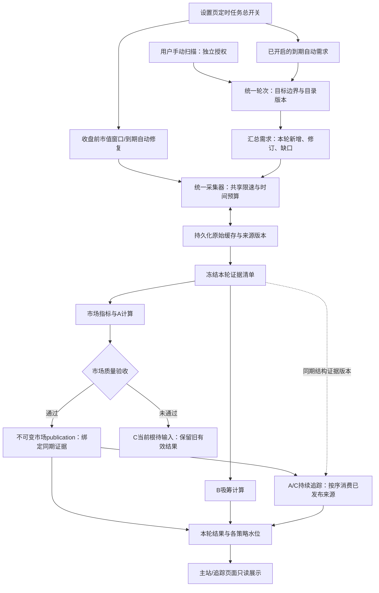

# 1024｜统一增量采集与ABC分类计算方案 v1.2

状态：待讨论、待审阅，未实施。日期：2026-10-21（北京时间）。用户明确要求先核实可行性、出方案，不更新生产代码或配置。

本方案承接1023，替代其“市场任务25分钟＋B任务20分钟”的最终架构建议；1023中的限流事件合并、冷却、恢复及截止时间保护继续适用；其“仅空闲才补齐”与单task续接等旧架构约束由本方案第8、14节替代。实现目标改为：**一轮增量采集，共享证据，分别计算ABC及其他指标，按结果质量发布和追踪。**

## 1. 核验结论：可以做，但不是把两个现有任务简单串起来

业务上，吸筹背离就是B策略，主站是展示ABC与其他指标的页面，不是另一套与B平级的策略。代码目前却有两个独立的采集执行分支：`scan`、`b_observe_1h`，因此产生重复目录/4H取数、不同数据更新时间及串行积压。

核验后的可行性判断：

| 判断 | 结论与条件 |
|---|---|
| 每小时只有一个统一采集入口 | 可行。现有单数据worker可继续使用，不需要增加采集进程或让两个任务并跑 |
| 复用已有数据、补新增与缺口 | 可行。B已有1H增量缓存、4H背景缓存和历史OI/LSR续接；主站需要改成从统一缓存取证据 |
| 同一份4H原始数据供ABC计算 | 可行。四个样本重叠内容一致，同输入EMA数值一致；各策略仍按自己的历史窗口/版本计算 |
| ABC只保留一个判定函数 | 不合适。策略周期、条件、确认、失效和事件账本不同，应保留现有计算器 |
| 所有字段都只请求一次即可 | 不能这样承诺。相同请求可合并，当前OI与历史OI、5m与1h账户比等不同语义不能替代 |
| 合并后一定不再418、固定几分钟完成 | 尚不能证明。供应商权重、网络、冷启动历史和本地业务回放均影响耗时，需要离线及自然轮次验收 |

此次已执行的是只读源码核查、原始归档hash校验、样本对比和复制纯函数的离线计算；未运行新的市场采集，未启动策略写入，未修改生产数据。

## 2. 当前代码实际如何运行

### 2.1 市场扫描分支

`scanner.py::_scan()`先读取两类合约市场目录、24H ticker、premiumIndex、fundingInfo及市值，再逐币取当前OI、5m全体账户比、最多1500根4H和1000根日线。之后执行分类、聪明钱读取、补查、候选深度复核、EMA候选状态更新和快照发布。

因此“已有历史保存在本地”不等于“下次网络只补新增”。本分支当前仍请求大段历史。`fetch_contract()`同时包含网络访问、K线筛选、指标计算，不能直接当纯计算器复用。

另外，`_scan()`中的EMA生命周期状态可能在市场快照质量验收前写入；实施时必须清点这些副作用，不能假定“快照发布失败就完全没有策略写入”。不能把本次拆分顺便改成另一套事件规则。

### 2.2 B分支

`task_service.py`另行执行`b_observe_1h`，重新读取交易目录，调用`PublicAdapters`和`run_b_observe_round()`。

- 1H通过缓存覆盖、缺口、末尾重叠和游标续接。
- 4H背景读取已有缓存，补前缀/缺口/尾部，并重读最后已收盘K线检查修订。
- 历史OI/LSR通过`source_resume.resume_source()`补采、保留修订和连续水位。
- B计算仍可能通过`reference_open`、`observed`回调请求下一根真实开盘和当前报价；不能只合并调度器而遗漏这些隐藏的网络入口。
- `process_bars_in_order()`提交事件、游标和outbox；这些幂等与历史重算能力应保留。

### 2.3 A/C持续追踪与展示

市场快照经`ScanArchive.publish()`，通过持久化publication/outbox进入`tracking_service`。`_publication_row()`再驱动A追踪、C引擎及持续观察。

关键依赖：`tracking_service.source_input()`不仅读取已发布4H归档，还读取`runtime/b-source/.../structure.json`中的历史OI、LSR和市值，以及已恢复的证据。**C与B已经存在输入依赖，不能把它们视为互不相关的两套数据。**

现有先市场扫描、再B取数的顺序，可能使C首次计算时尚未取得本轮B来源证据；这是依赖顺序风险，并非本核查已证明所有C缺口均由此造成。新架构应先取得各来源证据，再冻结清单供消费者读取。

本地ABC追踪worker可在市场发布后独立计算；它不能访问市场网络。该本地计算与单数据worker是两类工作，合并采集不要求把所有数据库处理强行塞进一个数据库事务。

### 2.4 补齐为何停在22:00:31

已核对页面“自动补齐…最近处理”取自`/api/collection/status.last.at_ms`，即最后有结果记录的补齐批次起始时间，不是全市场行情更新时间，也不是“缺口全部解决时间”。

`collection_recovery.tick()`发现任意非研究任务运行或排队就返回deferred；连续主任务积压会让补齐长期得不到通道。新方案需修改让出规则并提供有界份额，不能只让“已开启”的状态一直亮着。

### 2.5 本次复核补充：独立自动入口与重启续接

- `task_service.py::_tick_evidence_repair()`受`RepairStore.enabled()`控制，普通B证据修复不以市场或来源缺口补齐开关为前置条件。它还在B开启时于每小时55分起安排`b_cap_refresh`，保存实际的收盘前市值；两者均须纳入总开关和统一协调器。
- `tracking/runtime.py`另有`network_enabled`及grant约束；当前是否开启属于运行状态，不能因某次关闭就从架构入口清单中遗漏。未来启用时也须受总开关与共享通道约束。
- `countdown_schedule.py`保留一次性延迟触发能力；即使前端按钮已移除，已保存的倒计时及其续接需求也不能绕过总开关。
- `eval_store.py::scheduler_tick()`可能通过已授权的自动补取计划调用`submit_range()`。触发来源必须向后传递，自动产生的范围补采不能因使用同一个提交函数就被误认成用户手动采集。
- 重启时旧`queued/running`任务会被标为中断，但`ScanDemands._init_demands()`先保留其未完需求，`_consume_demands()`可能创建`boundary_resume`续接任务。因此，“原task ID不直接重跑”不等于“不会继续执行旧需求”。现行代码只是跳过逐个漏掉的计划时点；不能据此声称重启后没有任何积压或续接。

以上是本次只读复核的入口事实；下面5.1.1～5.1.3为拟议修复规则，当前系统尚未具有总开关。

## 3. 实物样本核查

采样：2026-10-21 01:30:33。主站已发布归档为`scan-757151fb181e417c8222be9b97526b4c`，保存完成时间10月20日20:09:54；它与当时可读B缓存的截止时间并不完全相同，因此只比较共同的时间键。

| 合约 | 市场归档4H根数 | B缓存4H根数 | 重叠时间键 | 重叠原始内容差异 | 同输入A/B、A/C的EMA最大差异 |
|---|---:|---:|---:|---:|---:|
| BTCUSDT | 1499 | 1660 | 1499 | 0 | 0 |
| DOODUSDT | 1499 | 1659 | 1499 | 0 | 0 |
| JCTUSDT | 1499 | 1658 | 1498 | 0 | 0 |
| BTCUSD_PERP（COIN-M） | 1499 | 1658 | 1498 | 0 | 0 |

检查实际manifest/chunk的SHA256后读取数据。EMA对比使用源码AST提取的纯函数：A的`ema_observations.states`、B的`b_evidence.background_at`、C的`c_rebound_rules.prepare_bars`；未导入运行生产模块。币本位成交量按归档合约乘数转成USD名义金额再送入C。

结论是这些样本**支持共用原始证据**，不是已经验证全部ABC策略结果一致；尚未验证全部合约、历史状态迁移、确认/失效、全部修订及运行吞吐。样本缓存是分文件读取，也不是跨文件的原子生产快照。

## 4. 数据需求清单：共用哪些，保留哪些差异

统一采集器汇总启用消费者的需求，按“交易场所＋可信合约身份＋来源＋endpoint＋周期＋单位＋时间范围＋质量版本”去重，不能只按币名或symbol合并。

| 来源/字段 | 当前消费者 | 统一后处理 |
|---|---|---|
| 两市场交易目录 | 市场、B、追踪身份 | 每轮同作用域读取一次，固定目录版本和合约分母；B仍覆盖整个合约目录，不缩成A候选池 |
| 4H原始K线 | A、B背景、C、其他量价指标 | 一份可信原始缓存；各消费者按固定规则截窗。历史缓存不足的消费者登记额外需求 |
| 1H原始K线 | B及其确认/追踪 | 保留现有增量和修订能力，由统一采集器执行；不在B计算器里自行联网 |
| 日线 | 现有归档/使用方 | 首次补足，再补缺口及修订；未新增时不每小时重拉1000根 |
| 当前OI | 主表、当前结构 | 按本轮获取，不用旧小时OI冒充当前值 |
| 历史1H OI | B、C同期结构证据 | 增量补样本，保留有效时间、首次可得时间、修订版本；不得直接替换当前OI |
| 5m全体账户比 | 主表现行指标 | 保留现行周期语义，不能直接改成1h |
| 历史1H账户比 | B、C同期结构证据 | 增量补取并共享；与5m请求分别存在 |
| 市值与资产身份 | 主表、ABC相关结构判断 | 可信来源及映射共用；当前市值与历史同期市值独立，不把当前值回填历史 |
| 24H ticker、标记价、费率配置等 | 主表及部分观察引用 | 同时段、同语义的批量行情本轮共用；保留每字段真实取得时间 |
| 下一根真实开盘、事件观察报价 | A/B引用或追踪 | 作为有明确用途的证据需求预取或追加采集段；不能用上一根收盘价代替真实开盘。未取得则待补 |
| 候选大户比、持仓比、结算历史 | 现行候选复核 | 基础计算后追加有界需求，走同一采集器；最终计算函数不得直接联网 |
| 聪明钱、储备等既有辅助来源 | 主表既有指标 | 保留现行行为、缓存与独立供应商约束；本方案不扩展覆盖、不重做已搁置的聪明钱规则 |

“统一”是同一批次负责完整的数据需求，不代表每币只有一个HTTP，也不代表所有字段同一毫秒产生。市场、周期、有效时间不一致的值不能因统一批次号而视作可互换。

## 5. 目标架构：一轮任务、一个采集入口、多个计算消费者

### 5.1 一次触发与兼容现有设置

- 默认每小时整点后120秒创建一个父轮次，记录`round_id`、目标小时T、目录/规则/配置版本和启用消费者。
- 主站与B不再分别创建会联网采集的独立运行任务；保留内部阶段和各自结果状态，兼容旧任务ID、操作记录与历史API。
- 原来的市场启用、B启用选项保留各自含义。只有B开启时，只汇总B及其依赖；不能因取消独立B调度而让B失去独立启停能力。
- 若今后市场间隔选择15分钟而B仍是1小时，统一入口汇总各自到期需求；不能擅自把B计算频率改成15分钟。本次仍以已选的每小时配置为验收对象。
- 手动“扫描”和计划扫描共享同一父轮次去重/串行通道，不创建绕过限速的第二入口；只读刷新页面不触发采集。

### 5.1.1 设置页「定时任务总开关」

这是**设置页面采集调度区域的总开关**，不是停止整个服务、屏蔽页面读取或禁止用户手动扫描的开关。放在该区域最上方，沿用现有控件、字体和配色；下方保留各子任务开关、周期和说明，不修改主站、追踪页的布局与信号分级。

| 项目 | 总开关关闭 | 总开关重新开启 |
|---|---|---|
| 市场自动扫描 | 不创建、不领取、不续派自动采集请求 | 仅原先市场子开关开启时恢复 |
| 1H采集＋B策略 | 同上，不能只停市场而B继续实采 | 仅B子开关开启时恢复，仍按1H边界处理 |
| 自动补齐来源缺口 | 停止自动补采及重试派发，保留需求/断点 | 按原开关、权限、冷却与预算继续 |
| B证据自动修复及收盘前市值预采集 | 均被总开关拦住；市值预采仍要求B及其原有修复开关允许 | 只恢复原允许项，不强行把B或修复开关打开 |
| 自动范围补取、来源runtime网络、遗留倒计时/续接 | 已启用者也受相同自动请求门禁；未启用者不顺带启用 | 仅合法到期需求恢复；过期一次性倒计时标为待用户处理，不补发旧测试扫描 |
| 用户当次明确点击手动扫描/手动范围补取 | 仍可使用，经过同一限流、预算和串行通道 | 同左，不借手动任务开启自动调度 |
| 已保存数据的查看、搜索、排序、只读刷新 | 正常使用，不因总开关关闭清空数据 | 同左 |

有效自动执行条件是“总开关开启＋对应子任务开启＋来源权限允许＋重试时间到期＋供应商准入及预算允许”。总开关仅作为上层门禁，不逐项改写子开关，不把手动执行授权扩大成后台自动补采授权。

总开关状态必须持久化：关闭后重启仍关闭；原本开启时重启沿用开启状态，但仍受5.1.3的恢复规则约束。旧配置无该字段时，按既有已保存子设置迁移出兼容状态，不自动启用原先关闭的子任务或隐藏网络入口；具体字段与schema在实现时确定，不能仅用前端本地变量保存。

总开关不等于全服务停机：本地已提交证据的计算、ACK/outbox收尾可继续，但不得隐式联网。其他独立研究/交易系统和旧Codex自动化不在此开关的实施范围，也不修改其状态；设置说明不能宣传成“停止电脑所有联网任务”。

### 5.1.2 暂停的服务端边界与在途收尾

1. 在任务创建、排队领取、续接/重试及**每次实际HTTP派发前**检查总开关；收到暂停后等待中的限流线程也须重新检查。只停止调度tick或只禁用前端按钮不算完成。
2. 自动排队任务/需求转为可恢复暂停态，保留身份、来源范围、游标、尝试及历史结果；暂停不记成已补齐，也不触发自动失败重试。关闭开关的设置保存与自动领取/派发准入需明确先后关系，防止竞态穿透。
3. 关闭时已获准派发的在途请求允许有界收尾，其响应可归档，已完成事务不回滚。其后继请求、自动重试和未发出的批次不得继续派发；底层socket/读取时限必须有界。
4. 设置页按实际状态显示“已暂停”或“正在收尾（在途N）”；若用户手动任务仍在执行，单独注明，不能声称全部网络为零。保存失败须显示失败，不能仅将开关画成关闭。
5. 自动与手动来源标签贯穿父任务、内部需求、回调和transport，不能只按task.kind判断。总开关关闭时手动扫描只完成当次明确范围，不顺带唤醒自动修复、预采集或旧续接。
6. 子开关或总开关变化时分清“配置已更改”与“采集/策略规则已更改”。保留旧任务配置与规则快照、事件ID及恢复映射，不因切换总开关或全局version变化而丢掉历史需求、重复事件或自动打开子开关。

### 5.1.3 关机、长时间暂停与重新开启：更新最新数据，不逐轮补跑扫描

需要分别保存旧执行任务记录、最新行情目标、历史来源缺口及B/C业务处理根。关机停止请求，不等于最新数据已采到、历史缺口已补好或业务根已处理；已发布快照也不会因启动而自动变新。

- 已结束/中断的旧任务结果保留，不原地修改其目标边界或伪装成功。启用消费者按原配置和`recoverMissed`含义恢复；允许合并补跑时，以恢复时最新已到期边界创建一个父轮次，记录与旧需求的关联，不为每个错过的小时各建一轮全市场扫描。若市场关闭`recoverMissed`，重启漏掉的市场计划不立即补跑，等待下一正常到期；不能借B恢复强行带起未到期市场消费者。
- 自动待执行目标按消费者、相容配置合并，最新行情优先，最多一个活动父轮次＋一份可合并的后续最新目标；正在运行的冻结轮次不被改写。连续预算失败不能让过期轮次反复占住实时通道；重试受截止时间/次数/退避约束，未完成范围进入有界恢复需求。
- 更新主站最新行情不要求先补齐所有历史小时扫描。但B的1H判定、确认与C历史业务根仍按原规则顺序续接；不能直接跳过缺失根、跳水位或把空白小时判为未命中。历史不足的策略明确显示待补/预热，保留旧有效结果及其边界。
- 冷启动优先取当前快照及最新计算所必需的窗口，同时登记中间缺口；最新窗口本身也不足时仍不能绕过质量门槛。长历史与业务回放按8节份额续接，不删除记录以制造“无积压”。
- 例如暂停一夜后，允许的新轮可先发布合格的最新市场数据，B/C仍显示各自待处理范围。新扫描必须同时满足覆盖和本轮新鲜度要求；扫描结束时间变新不能掩盖仍使用旧行情。

启动时的活锁/孤立锁核验、恢复执行段及operation映射必须按14.2节先完成，再开放采集领取；不能只处理数据库任务而忽略`scan.lock`。

### 5.2 固定时间边界

每小时轮次T派生1H边界T、4H边界`floor(T/4h)*4h`、日线边界`floor(T/24h)*24h`。日线沿用交易所UTC边界，通常对应北京时间08:00，不能因中文界面改成北京时间零点。

只将已收盘K线送入策略；下一根开盘引用另存角色，不作为已收盘K线参与EMA/量价。当前OI等即时字段另记观测/取得时间，不伪造成T时刻的历史样本。

### 5.3 阶段与依赖顺序

1. 固定本轮身份、目录和启用消费者，读取缓存覆盖；正常轮不重新初始化历史。
2. 把各消费者需要的新增范围、修订窗和缺口合并成来源需求；先取得本轮应有数据，冷启动/长历史单独分段。
3. 缓存写入完成后冻结“本轮证据清单”：每个来源块的hash、版本、有效范围、可得时间、质量、缺口；消费者不直接读随后可能变化的“最新文件”。
4. A/B及其他基础指标基于清单计算；有候选复核/真实开盘等额外需求时登记有界追加采集段，生成新清单revision，再重算受影响部分。禁止无限计算→补采循环。C及现有A持续追踪仍须经过已发布市场归档的来源验证入口：先通过市场质量门槛并产生不可变publication，再消费绑定的同期证据；不能直接把未发布的失败扫描行送进C。如果市场发布失败，C当前根保持待输入，B可按自身有效证据独立提交。
5. 按消费者提交现有事件、游标和持续追踪结果，记录每个ACK；汇总本轮状态并发布可见结果。
6. 在同一数据通道为历史补齐安排有界切片，完成后继续业务重算；后台获取证据不等于策略根已完成。

允许内部按合约分段流水执行，减少等待全部合约后才开始计算；但每次计算必须绑定冻结的来源版本，最终发布汇总有明确父轮次，不依赖共享可变字典。

需求按消费者分层：某个非关键辅助来源缺失，只阻塞依赖它的指标/策略，不无限阻塞全市场有效结果；市场关键来源仍遵守现有发布门槛，B/C完整性不因父轮次合并放松。记录缺失与依赖关系，禁止使用0、上一份当前报价或另一个周期的数据补成“完整”。

## 6. 缓存与增量：不是每次重新拉历史，也不是永不核对旧数据

### 6.1 主站接入已有缓存

现有`MarketCandleCache`有1H/4H覆盖及修订支持；`shared_candles`已有内容寻址的原始K线块；B还有4H历史manifest。应在这些存储之上增加统一读取/覆盖索引，不新建一份全量历史库。

特别注意：`MarketCandleCache.coverage()`当前周期表只有1H/4H，不能宣称日线已无条件支持。日线需补上索引/读取能力，或先为现有日线归档增加兼容覆盖索引，再经过回放验收。

旧缓存及scan-history先校验再登记，保留来源及首次可得时间；冲突版本并存，按可得时点/可信身份选择，不静默覆盖。按小批迁移并留游标，不长时间锁全库，不删除旧归档；现行清理开关保持不变，迁移/验收期间不能自动清理新引用到的历史块。

### 6.2 请求计划

- 有完整历史：补新收盘及必要重叠修订窗，不再每轮重拉1500/1000根。
- 有缺口：只请求缺口范围及校验重叠；最新范围保留份额，不能先补一个币几个月历史再处理全市场其他币。
- 没有缓存/新上市：分段补足各策略所需历史；不足时显示预热/缺口，不降低到“有一根就能算”。
- 4H没有新收盘时，仍可保留既有B的末尾小窗修订核对，但**只核对一次供各策略共享**。因此不能承诺非4H整点绝不发4H请求。
- 每小时1H末尾重叠沿用现有覆盖/修订语义；日线及4H的轮转历史复核由有界补齐队列安排，命中修订后重算实际受影响范围。
- 不用1H聚合值直接替换交易所4H/日线，除非另行验证并批准；此次继续使用交易所原始对应周期K线。

需要明确的限制：小窗修订核对无法保证发现上游对任意很早历史K线的无通知改写。若要求每小时发现整个历史窗口的所有上游改写，就仍需要整个窗口复核。这与“每轮只增量取数”不能无条件同时保证。建议采用末尾核对＋分段轮转复核，保存覆盖水位与发现后的修订回放，不承诺无法证明的全历史即时一致。

### 6.3 原始历史共用，计算窗口不擅改

B缓存样本有约1658～1660根4H，用于准备历史背景；B实际EMA背景方法取最后1499根。C明确限制1499根且冻结EMA/RSI初始化；A从市场归档窗口计算。

统一后共享的是原始历史，消费者继续选取自己的目标边界、窗口、初始化和量额单位。不能把1660根直接塞给C，也不能把A从滚动窗口改成全历史递推EMA。计算量减少可后续基于同输入对照优化，本次先重用已验证的计算器。

### 6.4 修订分别确认

当前B的`acknowledge()`会清理缓存待修订标记；C输入又会读取这些标记判断是否要回放。新管线不能依赖这种跨消费者共享的“已清空”标志。

每个来源版本/修订要有A、B、C等消费者各自的ACK或需求边。B处理完成只确认B，不得清掉C仍需要的修订。ACK必须在对应事件/游标事务提交后写入；宕机后重复执行保持幂等，不能跳根、重复创建事件或把历史补录当成本轮新信号。

## 7. 发布与展示：同轮次，不强行同一数据库事务

系统已有多个SQLite和文件快照，不能靠“统一任务”就假定它们能同时提交。保留市场publication/source outbox、B事件事务、ABC账本，增加父轮次清单/提交日志和各消费者版本映射。

建议发布规则：

1. 计算消费冻结版本、结果先持久化，各自有幂等commit和恢复记录。原始归档、合格市场publication、A/C消费ACK、聚合可见清单分层提交；不绕过原有来源验证。拆分scanner时把新增的A候选生命周期写入放在对应质量验收之后，避免新增失败快照继续推进可见策略状态；既有历史状态先审计保留，不追溯删除。
2. 聚合可见清单只引用已提交结果，原子推进可见轮次；读接口按该清单读取market revision、B round、A/C处理水位，不能再无条件拼“scan.json＋最新B＋最新C”。
3. 市场通过原覆盖门槛但B/C缺证据时，可发布有效市场结果，同时明确B/C本轮待核或待处理；保留各自上一份有效结果并显示其旧时间，不能标成已同步。
4. B有效而市场失败时保留B的已提交结果，不因父轮次部分失败回滚/删除真实事件；展示层能说明本轮哪些结果更新，哪些沿用旧版本。
5. 关键行情未达90%门槛仍保留上次合格市场快照；不把缺值写成0。现有门槛不因合并降低，亦不能声称现行数字覆盖检查已经验证所有字段的新鲜度。
6. 父轮次可部分完成，只有启用消费者所需来源和计算阶段均达到各自验收条件才标记全部完成。C合法缺历史同期市值时仍待证据，不能因归档成功而“已完成”。

适配现有`/api/unified/signals`与追踪列表的版本绑定；保持主站和追踪页面布局、配色、弱中强及策略名称，不借此重做UI。

状态只增加必要含义：统一轮次、当前阶段、当前轮各策略边界、最后合格行情时间、历史补齐等待原因、下次可执行时间。“调度心跳”“本轮采集结束”“全部策略已更新”分别记录，避免混为一个成功时间。

**覆盖与新鲜度分别验收。** 保留原90%关键覆盖门槛，同时为字段明确适用时间：1H/4H/日线检查各自本轮应有已收盘边界；24H ticker、当前OI及报价检查真实观测/取得时间和可接受时差，具体阈值实施前登记。非4H收盘小时复用最近一根完整4H属于有效复用；用上一个小时的即时字段冒充本轮值不属于。时间在当前代码未记录/无法证明的，显示新鲜度未知，不仅因数值非空就合格。

历史数据另记“有效时间、首次可得时间、本次补取时间、来源修订”。后来补到的历史值可用于注明的历史重算，但不能把取得时间伪写到过去，或当成当时已知的新信号；继续遵守各策略既有历史补录与追踪语义。

## 8. 小时预算、限流和补齐公平性

### 8.1 不再给两个独立采集任务各30分钟

建议父轮次从计划触发时刻起，主采集＋计算/持久化收尾合计目标上限45分钟；随后最多5分钟为历史补齐/恢复切片服务。每小时合计50分钟，余下约10分钟留给调度余量和异常收尾。它是待回放定标的保护初值，不是已证明能在45分钟处理全部合约。

每个父轮次记录计划时点、创建时点、实际开始及绝对截止。正常轮从计划触发时刻计算预算，排队/重试/追加需求不重置预算；重启后合法合并恢复则是有明确恢复时点的新轮次，不能沿用昨夜已经过期的截止时间，也不能给同一失败轮无限续期。HTTP发起截止比任务硬截止至少早30秒。底层线程无法取消时，必须证明socket/读取有界并收尾，不能旧请求还在执行就开始新轮。

历史长回放分段计算，不为补几十天业务状态而阻塞本小时所有合约。计算段与网络段分别计时，数据库锁仍受现有业务事务约束；需要保存断点并证明新旧根不越序。

### 8.2 补齐有保留份额

- 为已授权且到期的恢复需求保留最多5分钟总份额，内部仍用原有短切片（约20秒）和有界页/请求预算；存在合法可执行需求时还须提供14.5节定义的有界服务机会，不能只规定上限而长期分配0。
- 不能继续采用“只要队列有任务就永久不补齐”；由统一协调器在安全点调度补齐，并记录已获得/因封禁或配置未能使用的份额。
- 所有补齐仍走共享供应商权重和封禁保护；预留时间不等于必须发请求。封禁、配置阻塞、未来重试时间未到时不得强行补。
- 到下一轮边界让出；历史需求按来源/合约轮转和等待年龄分配，防止第一个长缺口长期占满。

### 8.3 降速故障必须同时修

1023已确认的“418逐条翻倍且无恢复”不会因合并任务自然消失。统一采集器必须继承：同批限流合并、Retry-After最长保护、封禁持久化、单探针、健康窗口渐进恢复、权重预算、可取消等待及真实HTTP遥测。

不能为赶45分钟提高线程、忽略限流或自动切IP；不能靠重启清空保护状态。futures具体endpoint权重/窗口仍需实施前核验，不能借用Spot额度。

### 8.4 收盘前证据与独立自动修复同样进入协调器

收盘前市值预采集不能简单挪到整点后120秒的主轮：前者保存的是收盘前实际观测，后者可能已经晚于业务边界，不能互相替代。保留既有每小时55分起的有效窗口及真实时间戳，只在总开关、B与对应修复控制允许时登记需求；由同一数据通道/供应商准入执行，不创建另一套worker或独立额度池。

预采集作为目标小时父轮次的前置证据段登记，修复按对应来源/业务根登记恢复批次；都有执行ID及归属关系，不再创建第二轮实时全市场扫描。前置证据无需等主轮才归档，主轮仅引用已提交版本；这不改变5节单一实时父轮次的约束。

45＋5分钟是主小时轮的预算初值，预采集、独立证据修复、自动范围补取等还须计入同一个滚动小时请求/权重/时间账本。将末尾可用时间明确划出预采集与在途收尾的保护窗口；主轮、恢复和手动请求在可取消安全点让出或在准入时解释冲突，不能把这些额外入口当成“免费时间”。同一来源需求已被本轮满足时只共享证据，不再重复补采。

若封禁、暂停或在途请求使收盘前窗口错过，记录真实缺口和原因；不能事后取当前市值倒填为收盘前证据。先通过完整需求容量估算，确认正常轮、预采集和恢复均有可用份额；若不能容纳，调整预算初值并重新审阅，不能声称45＋5分钟已经证明可承载所有任务。

## 9. 能减少什么、不能预先保证什么

可以明确消除的是独立B目录重读、两套4H需求重复执行、市场每小时重新下载大段4H/日线，以及部分同时间语义行情重复取数。保留的请求包括当前OI、5m账户比、B的1H K线和历史OI/LSR、必要修订和候选复核。

因此不能预先承诺“请求数减半”“速度恢复16倍”或“永不418”。有些优化只减少响应体大小及接口权重，不一定减少HTTP次数；必须分别测量次数、权重、流量、节流等待、网络耗时和本地计算。

容量验收需使用完整来源需求及官方已确认权重，分正常小时、4H收盘、日线收盘、冷启动四类估算。冷启动/长缺口单独分段，不要求一轮无条件补齐全部历史。

## 10. 代码改动范围与迁移步骤（待批准实施）

| 范围 | 需要做的事 |
|---|---|
| 调度/`task_service.py`、`scan_demands.py`、`countdown_schedule.py` | 父轮次、最新目标合并、自动来源标签、总开关与重启续接；取消独立联网B任务的重复触发，保留历史映射 |
| 设置页及设置API | 仅在现有定时任务区域增加总开关和必要状态；服务端持久化、兼容迁移、子设置保留、保存失败回显，不改主站UI |
| `b_repair_store.py`、B修复/市值采集执行路径 | 独立修复和收盘前窗口纳入总开关、同一通道及滚动预算；保留真实观测时间 |
| `tracking/runtime.py`、自动范围补取入口 | 遗留自动网络入口与派生任务传递来源，复用全局门禁及授权；纯本地消费不得隐式联网 |
| 新的统一来源计划/采集协调层 | 来源身份、周期、时间范围去重，权重准入、缓存覆盖与冻结清单；模块名称在实现时确定 |
| `scanner.py` | 拆开网络和纯指标计算，主站从清单取数；候选复核登记追加需求，清点生命周期副作用 |
| `b_observe_runner.py`/`b_public_adapter.py` | 复用增量与计算器；计算入口只读冻结数据，reference/quote转为已采证据或待补需求 |
| `market_candle_cache.py`/`shared_candles.py` | 原始存储复用、日线覆盖支持、版本索引与修订分发；避免迁出/重建整库 |
| `snapshot_store.py`/`tracking_service.py` | 保留既有outbox/ACK，增加统一轮次绑定；C读取已冻结同期证据，不等下一轮B刷新；租约所有权核验及启动恢复按14.2节实现 |
| `collection_recovery.py` | 从“队列全空才执行”改成协调器安全点有界份额；权限、来源身份、重试及业务根ACK规则不放松 |
| `unified_workbench.py`/状态接口/追踪读取 | 同轮次版本绑定，分开显示来源、策略和补齐水位；不改页面设计或信号分级 |
| `request_pacer.py`/`request_gate.py`/transport | 落实1023限流恢复与贯通预算；所有入口统一覆盖 |

迁移顺序：

0. **恢复与保护离线验证。** 先验证限流恢复、绝对截止、自动门禁、租约/任务恢复及分层状态判定；未通过不得切换新实采入口。
1. **基线与存储盘点。** 固定代码/配置指纹和可读源版本，记录事件ID、状态、水位、未决根、缺口；迁移前增加同范围key/hash清单。
2. **共享缓存和需求规划。** 索引复用旧归档，不联网的旧新读取对照；确认日线支持、身份映射及币本位单位。
3. **纯计算适配。** 让旧计算器在隔离副本上消费同一证据清单，拦截所有网络调用；核对ABC和辅助指标结果。
4. **统一调度和发布。** 父轮次、消费者ACK、结果可见清单、恢复份额与1023保护联调；旧调度此时尚未并行启用新采集。
5. **切换。** 受控窗口备份文件/配置、等待在途任务有界结束，再启用唯一采集入口；不强杀在途生产、不并跑两套实采。
6. **自然轮次验收。** 按第11节观察，不另开全量测试扫描；未达到验收条件标为部分实施，不能宣布修复完成。

历史task、scan_id、B round、事件ID及原文件保留，新父轮次记录映射。旧版本状态迁移采用追加兼容字段，不把既有事件重新编号或重新导入成新信号。

回滚时保留已采证据、事件、ACK和未到期封禁；需先证明新旧结果格式可读，再切回唯一旧入口。无法兼容时保守停止该来源派发并报告，不能同时运行新旧采集器或清空数据库解决。

## 11. 验收标准：先离线证明，再自然轮次证明

### 11.1 离线与隔离副本

| 验收项 | 必须证明 |
|---|---|
| 数据去重 | 同身份/周期/单位/时间需求只采一次；5m与1h、现值与历史等差异仍保留 |
| 全覆盖目录 | B不因市场失败或A候选筛选缩小分母；新上市、币本位、退市、改名有明确处理 |
| 增量读取 | 同证据、同目标边界下旧全量窗口与新缓存窗口的内容一致；日线UTC边界正确；缺口不跨接 |
| 指标与信号 | ABC及其他指标的数值、触发时间、弱中强、确认/失效、资格unknown、历史标记保持；浮点微差不能跨阈值改变事件 |
| 状态续接 | 重启、重复回放、B提交后C未提交、源修订后局部失败，均不重复事件、不跳历史根、不提前清修订ACK |
| 发布一致性 | 崩溃发生在各提交步骤时，读接口只引用已提交版本；不同来源/策略落后时明确标记，不能混成“本轮全成功” |
| 网络隔离 | 计算阶段和页面只读阶段没有隐式HTTP；候选/开盘等额外需求必须由协调器执行 |
| 限流及预算 | 模拟429/418、同批响应、重启、长冷却、慢响应体；不越过封禁、不无限等待、不让旧在途请求与新轮重叠 |
| 补齐公平性 | 主任务连续排队时恢复仍可获得有界份额；供应商阻塞时解释未执行，不伪造已补齐 |
| 总开关 | 分别在排队、限流等待、在途、重试和追加采集阶段关闭；暂停确认后不派发新的自动HTTP，在途有界收尾，已有数据不清空 |
| 启停与重启 | 总关→重启仍总关；重新开启保留各子设置；不自动打开原关闭项，不补发过期倒计时，旧需求与事件映射保留 |
| 自动/手动边界 | 总关时手动当次扫描仍可用，但不能唤醒自动修复；自动范围补取不能伪装手动任务绕过门禁 |
| 一夜暂停后恢复 | 最新市场目标合并，不逐小时全市场补跑；B/C缺失根不跳过、修订不丢弃；既有recoverMissed与子开关语义正确 |
| 预采集与预算 | 收盘前观测时间真实，同通道且计入总账；错过窗口显示缺证据，封禁/暂停后不倒填 |
| 新鲜度 | 完整旧缓存＋新完成时间不能伪装新快照；即时字段、1H、4H、日线按各自时间标准验收 |

旧新对照使用同一份已保存输入和同一规则/可得时间，在项目外隔离副本计算；禁止为对比让生产新旧采集同时访问币安。阶段测试代码只写项目外或批准的测试目录，不覆盖生产缓存。

### 11.2 自然轮次

至少连续3个自然小时轮次通过，并覆盖4H收盘；日线增量还需覆盖一次交易所日线收盘自然轮次，或先以隔离回放作为阶段证据、明确真实日线边界观察尚待完成。

- 每个计划边界只有一个父采集轮次，主站/B没有第二套重复采集；旧任务映射及启停功能正常。
- 正常来源条件下，市场合格快照按小时发布，B所需合约完成评估，C按应处理的4H边界提交或明确缺证据；结果绑定正确来源版本。
- 真实遥测给出请求数、可验证权重、响应流量、429/418/超时、各阶段耗时及预算；不根据scheduler心跳或task.error为空宣称正常。
- 观察补齐份额实际执行、来源归档和业务根生效；遗留权限/配置/402/历史市值缺失逐项保留，不因架构切换消失。
- 对比迁移前建立的同范围key/hash、事件ID、水位和需求账本；没有完整基线时明确验收覆盖，不能承诺全量无损。

若性能仍不达标，按遥测定位权重、网络、候选复核、本地回放、数据库处理；不得直接增加线程、降低质量门槛或缩短策略历史窗口来通过验收。

## 12. 本次核查产物与审阅结论

源码定位、SHA256、样本归档参考和纯计算结果已保存在：

`C:\Users\ls569\.codex\visualizations\2026\10\12\01a12f09-8e85-72b1-885d-668752d27af6\abc-execution-1017\codex-audits\1024-unified-collection-feasibility\feasibility-evidence.json`

只读审计脚本为同目录`inspect_feasibility.py`。1023原有限流/任务时间线证据仍在相邻`1022-implementation/hourly-refresh-diagnosis`目录。

最终建议：批准方向应为**统一增量采集＋独立策略计算与消费者ACK＋同轮次结果绑定**。不建议继续保留两套实采再仅调整各自时间上限。本次证明了共享原始证据和复用计算器的基础可行性，完整迁移仍需上述实现及验收；未部署、未修改生产代码/配置。

## 13. v1.1复核结论与仍需实施前定标的事项

本次保持“先讨论、只更新方案”的边界。整体方向可行，但v1.0有以下遗漏或表述不严，现已补正：

| 问题 | 本版处理 |
|---|---|
| 缺少设置页定时任务总开关，独立B修复/市值及遗留自动入口可能继续联网 | 5.1.1～5.1.2列入口、服务端派发门禁、暂停收尾和持久化语义 |
| 重启标中断容易误读成全部旧需求消失 | 2.5记录durable demand续接事实；5.1.3分开最新行情与历史来源/业务根 |
| 从旧计划时点计算截止时间与长暂停恢复存在冲突 | 合法恢复创建最新目标新轮；同一轮重试不续预算，不逐时补跑 |
| 架构图将C画成直接消费冻结清单，未画市场发布门槛 | 图中补上市场验收/publication；C仍走已发布来源与同期证据 |
| 45＋5分钟未明确包含独立修复与55分预采集 | 8.4纳入滚动总账并保留时窗；该预算仍是待容量验收的初值 |
| 仅覆盖达标可能把完整旧数据误称本轮已同步 | 第7节补字段新鲜度、各周期边界与真实取得时间检查 |
| 非关键字段缺失可能让统一轮次等待所有来源 | 分消费者依赖与状态，保留市场质量门槛，允许有效结果独立提交 |

仍需实施前确定并验证：官方endpoint权重与真实额度作用域；即时字段可接受时差；修订窗/轮转覆盖周期；完整目录正常小时、4H/日线边界及恢复/预采集的容量；多存储崩溃恢复与旧格式兼容。它们是下一阶段的实施及验收条件，不代表当前已经实现或吞吐已达标。

审阅结论：可继续以本版作为实施设计基础；不建议只增加一个前端总开关就宣称限流和积压已解决。**本次仅修订1024及文档索引/登记，未改代码、设置、运行任务或已有业务数据。**

## 14. v1.2｜恢复后复核：实施前必须补齐的约束

复核日期：2026-10-21，北京时间。用户授权本轮核对并将结论保存到方案；本轮仅修订文档与登记，不修改生产代码、配置或运行任务。统一采集架构仍未实施。此前按用户要求执行的速度恢复、服务重启和一次性孤立锁/队列恢复属于独立运维操作，不代表1023/1024已上线。

### 14.1 本轮实测及证据边界

| 对象 | 结果 | 不能据此推出的结论 |
|---|---|---|
| B1H续接任务 `task-7201b19960a2424497c9462e19755850` | 02:11:53～02:28:33；587/587评估；3189次HTTP尝试全部200；任务success | `coverage_status=incomplete`，不能说历史证据全部完整或业务根全部闭环 |
| 4H恢复任务 `task-1f2986daa243479da4684ded7f981502` | 02:28:33～02:34:46；587/587；2374次HTTP尝试全部200；partial_success且quality.accepted=true；02:34:44已产生合格publication | closed4h覆盖586/587，仍有1份4H指标缺项；收到全部合约行不等于所有字段齐全 |
| 两恢复任务合计 | 5563次HTTP尝试，记录均为200，未记录新418/429；单worker先B后4H串行执行 | 不是整个出口IP或其他进程无异常的证明，也不是统一增量架构的容量验收 |
| B来源与业务覆盖 | 35份合约仍有OI来源gap，32份有LSR来源gap；6份有待证据业务根，1份有未决处理根；这些集合可重叠 | 不是新增故障数量，不等于缺少相同数量K线，也不能将各列相加当合约总数 |

B的`continuation_required=false`只表示当前K线分页没有要求立即续页；它与历史OI/LSR缺口、业务根待证据不是同一个状态。本轮`missing=[]`、`errors=[]`也不能覆盖掉来源游标及业务账本中仍存在的未决项。

4H的验证摘要另列聪明钱未覆盖543项、市值口径2项及美元换算排除5项；它们须沿用既有缺失/排除语义，不能一概算成本轮网络故障。本方案不扩展已搁置的聪明钱覆盖。必需市值584/584可信；用户既有排除项不当成新的待补错误。

证据：本方案原核查证据目录中的`1024-review-after-recovery-evidence.json`，采样02:37:00；含两任务结果、来源游标、未决项与文档hash。上述数据是固定恢复轮次事实，不是此后实时状态。

### 14.2 P0：补上重启时的锁与任务恢复协议

源码`ScanLease`使用排他创建`scan.lock`，正常退出才删除。此次停止旧进程后锁仍归属旧PID32208，自动续接4H因此立即失败；确认旧进程退出并归档锁后，恢复任务才正常执行。这是独立于418的新故障路径，原5.1.3仅描述需求续接，尚不足以防止复发。

实施要求：

1. 优先支持有界优雅关闭：停止领取与新派发，等待在途收尾、提交断点并释放当前租约。异常崩溃/断电仍走下面的启动恢复流程，不能依赖正常退出一定执行。
2. 服务启动先完成实例、租约与任务账本核对，再开放采集领取。租约记录实例ID、进程创建时间、数据根标识和不可重用的owner token；PID存在/不存在、锁文件年龄或心跳单独任一条件均不足以安全回收。处理PID复用、双实例、权限不足及损坏锁；无法证明原持有者已退出时保持阻塞并说明原因，不静默抢锁。
3. 原持有者确认退出后，在跨进程互斥保护下再次核对租约token，只归档该孤立锁。文件归档与SQLite任务更新不能假装是一个原子事务：使用可重放恢复记录，覆盖“已归档未入队”“已入队未更新关联”等崩溃点。释放租约也核对owner token，避免旧收尾删除新持有者的锁。
4. 保留原失败/中断任务；恢复执行段关联原operation、demand、目标边界、规则/配置版本及原任务ID，并原子维护数据库内的关联。一个来源需求最多一个可领取执行段，重复启动恢复幂等，不直接照搬此次人工写库脚本为生产恢复入口。
5. 原operation返回当前执行段及历史链。页面明确区分“旧执行失败”“已恢复排队”“恢复运行中”“部分完成”；不能因旧失败继续显示整轮无法恢复，也不能入队后立即显示成功。
6. 服务重启不清除未到期封禁、已记录降速阶段或自动暂停状态。关机再启动也适用5.1.1～5.1.3；用户此时关机不授权明日启动新测试扫描。

新增验收：正常退出、强制退出、锁写一半、PID复用、双实例启动、归档/入队中间崩溃、operation映射更新中断；均不双采、不误抢活锁、不重复事件，且能保留并解释旧失败记录。

### 14.3 P0：执行结果和证据完成分别判定

第7节的分层状态需落实为服务端可验证的判定，不仅增加提示文案：

| 维度 | 判定依据 | 未满足时 |
|---|---|---|
| 本段执行 | 请求/计算是否按计划执行、真实错误和取消原因 | 失败、暂停、冷却或部分执行，保留断点 |
| 本轮市场可发布 | 原有关键覆盖门槛、字段有效性及本轮新鲜度；记录scan/publication/revision | 保留旧有效市场结果并标明时间；部分合格仍显示具体缺项 |
| B本轮处理 | 冻结目录分母、评估/预热/失败合约及目标边界 | 不把“遍历完目录”视为全部评估成功 |
| 来源覆盖 | 各来源连续水位、gap、待修订、范围与适用性 | 分开标注本轮范围与历史范围待补；不能仅看HTTP200、missing或errors |
| 业务生效 | 每消费者ACK、未决根及待证据根 | 归档不当生效；没有续页也不当作闭环 |

父轮次应区分“本轮启用消费者的必需范围已完成”和“历史修复仍待处理”；无关的长期历史需求不永久阻止本轮终态，但仍明确保留。未知、不适用、已排除及缺证据分别表达；不得写0或把unknown当未命中。不得因这次复核调整ABC、弱中强或历史事件规则。

### 14.4 P1：把时间、HTTP次数和供应商权重的边界写死

1. 第8节45＋5分钟仍是待定标初值。正常轮截止以计划触发时点为基准，排队不续时；同一轮重试、执行段切换及追加采集不能重置截止或HTTP总账。合法最新目标恢复可创建新父轮，但记录旧范围映射及跨轮供应商窗口，防止靠创建新ID无限重试。
2. 合并后不保留“市场6000＋B6000”两套独立可消耗额度。统一记录父轮HTTP上限、各阶段子预算及滚动供应商权重；子预算不得扩大父预算。父轮上限需依据完整需求核算后明确配置，不能未经验证把旧6000直接当最终统一上限，也不能默认增加到12000。此次5563次只是恢复样本，不证明每个正常轮都低于6000。
3. 实际发出的每次尝试只扣一次；重试和恢复探针同样计费，缓存命中及未发出的等待不计HTTP。预采集、独立修复、恢复切片、手动请求有各自归属，但都进入相同供应商滚动窗口，不能在整点刷新额度。
4. 保留原8次/秒配置的运维恢复不等于官方额度已核实。实施前必须核验实际futures endpoint及参数权重、官方作用域和可用量头；沿用1023的同批限流合并、冷却持久化、单探针和健康恢复，不能以本轮全200替代这些要求。
5. 新鲜度阈值、修订窗与轮转周期属于上线前登记项，必须有数值、来源和回放证据。未定标时不得将第7节的新鲜度检查标为已完成。

### 14.5 P1：补齐不能只有“最多5分钟”，还需可验收的服务机会

第8.2节原文“保留最多5分钟”只定义上限，单独使用仍可能始终分配0秒。补充规则：正常小时存在已授权、到期、未受供应商/配置阻塞的可执行恢复需求时，协调器必须在主轮截止前后的规定安全点提供有界切片机会，并记录分配、实际使用和未执行原因；持续可执行却没有服务机会必须可检测。

首次容量标定明确每小时最小机会/最长等待界限、最大5分钟总量及让出点；封禁、暂停、没有合法需求时不要求发请求。不能为保证补齐而突破下一轮或55分预采集保护窗口，也不能强行打断持有业务事务的计算。容量不能同时容纳时明确报告不达标，重新审阅预算，不暗中改为补齐长期饥饿。

### 14.6 文档优先关系与实施次序

- 小时架构、父轮次预算、补齐公平性及新旧任务恢复关系以1024为准。1023中“25＋20分钟”“仅无主任务才补齐”“必须沿用单个旧task ID”的旧架构表述不再作为1024实现要求；1023限流保护、遥测、时间贯通及历史证据仍保留。
- 先离线完成限流状态机、绝对截止、自动门禁、租约/任务恢复和状态判定的故障注入；再进行共享缓存及计算适配、唯一入口切换和自然轮次验收。旧新读取/计算对照不同时联网，缓存迁移也不得开第二套实采。
- 当前已有数据继续保留。迁移和验收不通过删除旧1H、清空缺口、重建事件ID或缩短策略窗口来达标。
- 45＋5分钟、父轮HTTP上限、官方权重、修订窗/新鲜度、补齐服务机会仍需实施前定标。已写明规则不等于这些参数已经有充分容量证据。

复核结论：**统一增量采集、ABC分别计算、结果绑定的方向可行；v1.2补齐上述约束后可作为下一阶段实施设计依据，仍不能视为已部署或已完成完整容量验收。** 用户休息/关机期间不另开测试、不创建新监控；后续实施另按用户指令执行。
